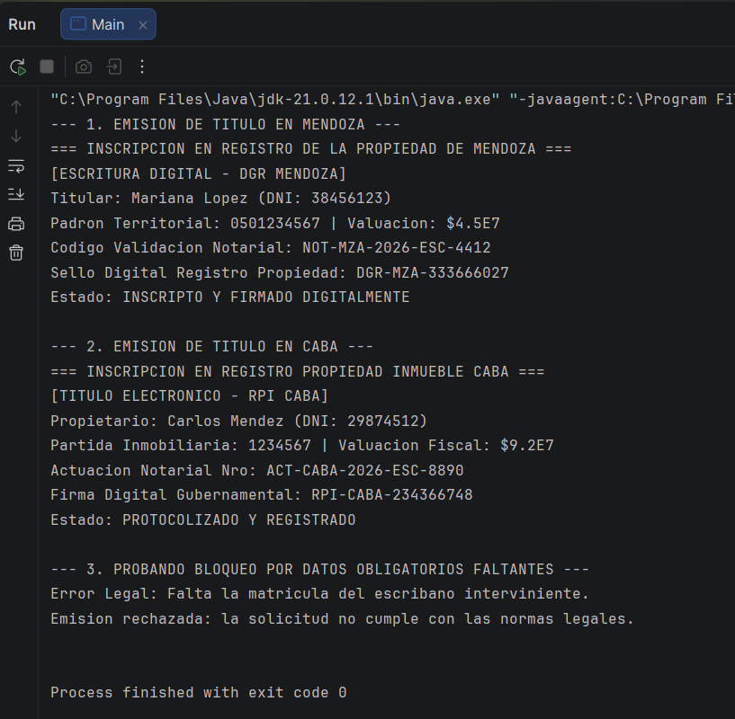

- Diseño de Software - Módulo 3
- Ejercitación 3.E.2 - Patrón Factory Method
Ejercicio 10: Sistema Empresarial de Emisión de Títulos de Propiedad
Contexto del problema:
En un sistema notarial automatizado, la emisión de títulos legales debe ajustarse estrictamente a las normativas registrales de diferentes jurisdicciones, requiriendo validaciones de identidad, sellados digitales y formatos documentales regulados por cada entidad gubernamental.

Objetivo de aprendizaje:
Desarrollar un Factory Method robusto de grado empresarial que combine seguridad estricta, validación de reglas legales complejas y protección contra errores de instanciación.

Requisitos funcionales:

Construir títulos de propiedad electrónicos que incluyan códigos de validación notarial y firmas digitales generadas según las leyes de la jurisdicción emisora.

Validar la integridad de los datos legales antes de permitir que la factoría devuelva el documento oficial listo para su registro.

Restricciones técnicas:

La implementación de las factorías y sus productos debe ser completamente segura ante entornos multihilo y resistente a intentos de inyección de parámetros inválidos.

La estructura debe impedir la creación de documentos legales si los datos obligatorios de la jurisdicción no están presentes en el contexto de la solicitud.
***
# Lógica y Funcionamiento del Programa:
    Para resolver este ejercicio apliqué el patrón Factory Method para encapsular las reglas registrales, validaciones catastrales y formatos oficiales de cada jurisdicción antes de permitir emitir un título de propiedad.

- Clase SolicitudTitulo: Agrupa los datos de entrada de la operación notarial. Se diseñó como una clase inmutable (atributos private final sin métodos setters) para proteger la integridad de la solicitud, evitar alteraciones concurrentes y bloquear intentos de inyección de datos inválidos durante el proceso.

- Interfaz TituloPropiedad: Define el contrato común con generarDocumentoOficial() y registrarTitulo().

- Clases TituloMendoza y TituloCaba: Son los productos concretos, también inmutables. Cada uno arma el formato documental regulado por su entidad registral junto con el código de actuación notarial y el sello digital correspondiente.

- Clase FabricaTitulo: Es la fábrica base abstracta que valida los requisitos legales generales (nombre y DNI del titular, matrícula del escribano y valuación fiscal positiva) y selecciona la factoría adecuada según la jurisdicción.

- Clases FabricaMendoza y FabricaCaba: Son las fábricas especializadas. Cada una verifica los datos obligatorios propios de su jurisdicción (padrón territorial de 10 dígitos en Mendoza y partida inmobiliaria de 7 dígitos en CABA) y recién si todo es válido construye el título; ante cualquier dato faltante o inválido, bloquea la creación devolviendo null.

- Clase Main: Probé emitir y registrar un título válido en Mendoza, uno en CABA y una tercera solicitud incompleta para comprobar que la factoría impide generar documentos legales inválidos.
***
# Ejecucion por consola
